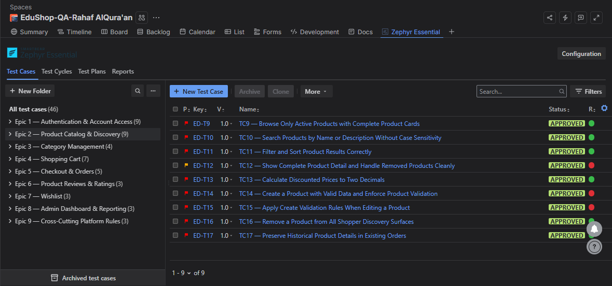
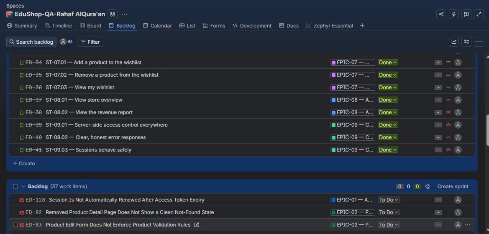
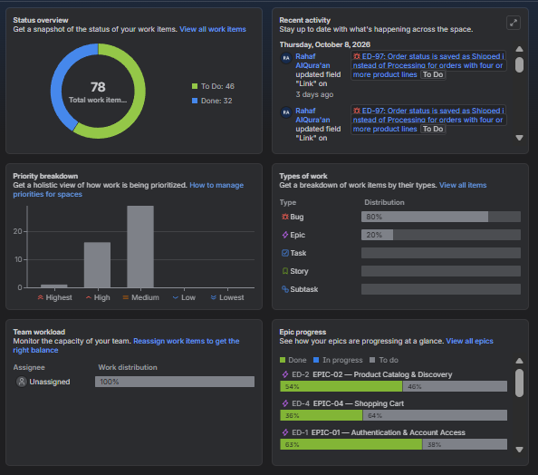

# EduShop QA Testing Project

**Manual & API Testing**

9 epics · 32 user stories · 8 API resources · 32 endpoints

Test design, execution evidence, API requests, and Jira defect tracking for the EduShop project.

**[Explore the Jira project space](https://rahafrsq.atlassian.net/jira/software/projects/ED/boards/101/backlog)** · **[View test evidence](#test-evidence)** · **[Run the Postman collection](#run-the-api-collection)**

## Project at a glance

- **Manual testing:** 46 Zephyr test cases organized across nine epics, with execution and traceability reports.
- **API testing:** a Postman collection, an execution workbook, and coverage of eight API resources and 32 endpoints.
- **Defect tracking:** 37 Jira bugs represented here as 22 manual and 15 API issues.

## Testing approach

1. Organize requirements and user stories by epic in Jira.
2. Design manual test cases in Zephyr and API cases in the execution workbook and Postman.
3. Execute tests, compare actual results with expected results, and record PASS/FAIL outcomes.
4. Log defects in Jira and connect test results back to the related work items.

### Testing highlights

- **Stock boundary testing:** Checked invalid values on both sides of the stock rule. A product update accepted `stock = -1` instead of rejecting it ([manual ED-127](https://rahafrsq.atlassian.net/browse/ED-127), [API ED-113](https://rahafrsq.atlassian.net/browse/ED-113)). A cart update also accepted **51 units when only 50 were available** ([API ED-118](https://rahafrsq.atlassian.net/browse/ED-118)).
- **Token and session testing:** Sent a malformed access token to the refresh endpoint; it returned **400** with a JWT parsing error instead of the expected **401 Unauthorized** ([API ED-111](https://rahafrsq.atlassian.net/browse/ED-111)). After an access token expired, the application redirected the user to Login instead of renewing the session with a valid refresh token ([ED-128](https://rahafrsq.atlassian.net/browse/ED-128)).
- **Dashboard data validation:** Compared Epic 8 dashboard and report values with read-only [PostgreSQL verification queries](sql/epic-08-dashboard-validation.sql), including revenue, users, products, orders, low stock, recent orders, and top-selling products.

## Tools used

- **Jira + Zephyr Essential** — stories, test cases, execution results, traceability, and defects.
- **Postman** — API requests and test scripts.
- **Visual Studio** — development and debugging environment used with the project.
- **PostgreSQL** — application database.
- **Docker** — local application services.

## Repository guide

### Manual testing and Jira

- [Manual test cases](jira/jira-manual-test-cases.xlsx) — exported cases, steps, and expected results.
- [Manual bugs](jira/jira-manual-bugs.csv) — 22 Jira issues.
- [Jira project space](https://rahafrsq.atlassian.net/jira/software/projects/ED/boards/101/backlog) — the project's backlog; Jira access may be required.

### API testing

- [API test execution](api/api-test-execution.xlsx) — test cases, results, and a Bugs sheet.
- [Postman collection](api/edushop-api.postman_collection.json) — API requests and test scripts.
- [Postman environment template](api/edushop-api.postman_environment.json) — credential and token values are blank.
- [API bugs](api/jira-api-bugs.csv) — 15 Jira issues.

### Database validation — Epic 8

- [Dashboard verification queries](sql/epic-08-dashboard-validation.sql) — nine read-only PostgreSQL queries used to check the Admin dashboard and reports against the database.
- Run the queries on the same database used by EduShop and compare their outputs with the UI at approximately the same time. Monthly revenue follows the database's current month and time zone.

## Test evidence

### Zephyr test cases and results

The test case view shows the manual suite organized by epic. The reports show individual **PASS** and **FAIL** outcomes, test steps, and links between tests, requirements, and Jira issues.

- [Execution results — overview](evidence/reports/zephyr-execution-results.pdf)
- [Detailed execution results — steps and actual outcomes](evidence/reports/zephyr-detailed-execution-results.pdf)
- [Traceability report — requirements, tests, and issues](evidence/reports/zephyr-traceability.pdf)

### Jira planning and progress

The screenshots show the backlog and a point-in-time project dashboard. The dashboard's **78 total**, **32 Done**, and **46 To Do** numbers refer to Jira work items, not test pass rates.

## Run the API collection

1. Import the [collection](api/edushop-api.postman_collection.json) and [environment template](api/edushop-api.postman_environment.json) into Postman.
2. Select the environment and set `baseUrl` to the local EduShop API address.
3. Add the required account emails and passwords in your local Postman environment. Keep real credentials out of Git.
4. Review the request order and test data before running; some requests create, update, or delete data.
5. Record execution results in the [API workbook](api/api-test-execution.xlsx) and link confirmed defects to Jira.
